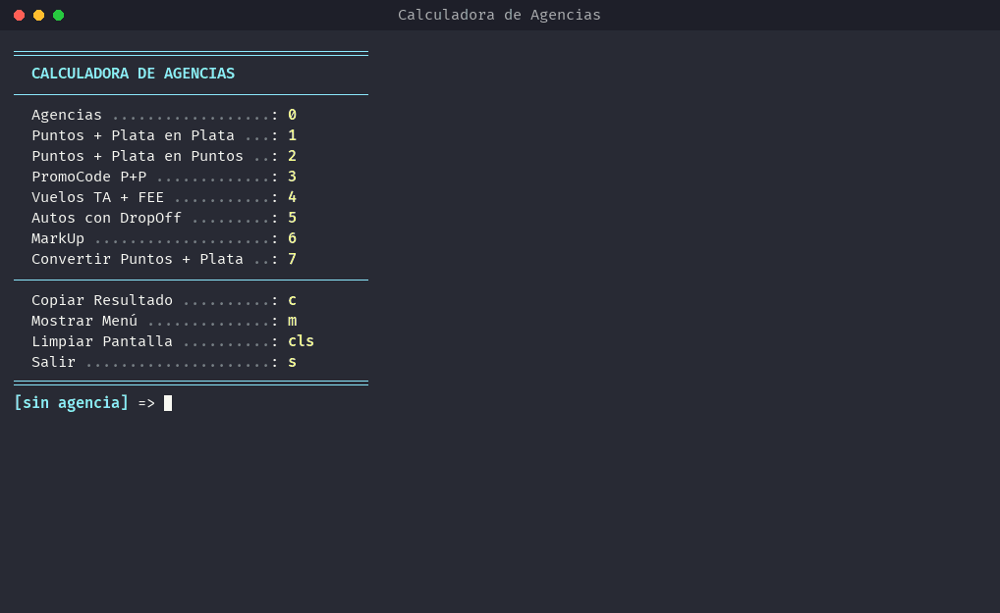

# Calculadora de Agencias

Programa de consola en Python para QA de marketplaces de viajes. Recalcula puntos + plata, promocodes,
TA y FEE de vuelos, DropOff de autos, MarkUp y conversión de moneda, para verificar que lo que cobra
cada agencia coincide con lo que debería cobrar según Sabre.



> **Datos de ejemplo.** Los nombres de agencias, valores, IDs, URLs, usuarios y contraseñas de `src/marketplaces.json` son
> ficticios (varios hacen guiño a animes) y solo muestran cómo funciona el programa. No corresponden a la configuración real de
> ninguna empresa.

```text
┌─ Vuelos TA + FEE ──────────────────┐
│ Agencia                1.291,5 MXN │
│ Calculado desde Sabre  1.290   MXN │
│ Diferencia                 1,5 MXN │
│ ✘ La agencia cobra de más          │
└────────────────────────────────────┘
```

## Instalación

Requiere Python 3.10 o superior.

```powershell
pip install -r requirements.txt
```

```powershell
cd src; python calculosAgencias.py
```

En Windows también se abre con doble clic en `calculadora.bat`. No necesita `.env`: todo vive en
`src/marketplaces.json` o se pide por consola.

## Uso rápido

1. Escribe `0` para ver las agencias y sus códigos.
2. Escribe un código para cargar la agencia, por ejemplo `cap` o `kon-gt`. Verás su ficha.
3. Elige un cálculo del `1` al `7`. Antes de calcular puedes corregir los valores que se van a usar.
4. Escribe `c` para copiar el resultado, o `x` en cualquier pregunta para cancelar.

## Cálculos

| Código | Opción | Fórmula |
|---|---|---|
| `1` | Puntos + Plata en Plata | `puntos × punto + plata` |
| `2` | Puntos + Plata en Puntos | `puntos + plata ÷ punto` |
| `3` | PromoCode P+P | fijo = `P+P sin − P+P con`; % = `fijo × 100 ÷ P+P sin` |
| `4` | Vuelos TA + FEE | `Sabre + TA + FEE`, comparado con el P+P pagado |
| `5` | Autos con DropOff | DropOff = `MC + DOC` (en Europa solo `MC`); renta en Sabre = `AP − DropOff` |
| `6` | MarkUp | `precio + precio × MarkUp% + MarkUp fijo` |
| `7` | Convertir Puntos + Plata | P+P convertido a otra moneda |

- **TA** (tarifa administrativa): fija por pasajero **o** porcentual sobre la base, nunca ambas.
- **FEE**: fijo por pasajero, porcentual sobre la base, o los dos.
- **Banco Konoha Costa Rica** (`kon-cr`): en la opción `4` muestra además el cobro en CRC, porque ahí Sabre
  responde en colones.
- Puntos y plata se piden según el modo de pago de la agencia: `puntos_plata`, `solo_puntos` o
  `solo_plata`. En `solo_plata` se bloquean las opciones `1` y `2`.

## Comandos

| Comando | Qué hace |
|---|---|
| `0` | Submenú de agencias: lista, gestión y ayuda |
| `edt` | Edita la agencia cargada |
| `new` | Crea una agencia, o un país de una existente (`kon-mx`) |
| `del` | Elimina una agencia, un país o todos los países de una agencia, con confirmación |
| `id` `um` `ua` `us` `pw` | Copia ID, URL del marketplace, URL del admin, usuario o contraseña |
| `cap-id`, `kon-gt-pw` | Carga la agencia y copia el dato en un solo paso |
| `c` | Copia el valor final del último resultado |
| `m` / `cls` / `s` | Menú / limpiar pantalla / salir (pregunta si guardar los cambios) |

La contraseña se copia al portapapeles y no se muestra al consultarla.

**Números:** `10.000` es diez mil y `10,5` (o `10.5`) es diez y medio. En tasas y valores de
configuración, `17.857` se rechaza por ambiguo: se escribe `17857` o `17,857`.

**Tasas de cambio:** se consultan en [open.er-api.com](https://open.er-api.com), con valores de respaldo
si no responde. Se muestran antes de convertir y se pueden corregir a mano.

## Catálogo de agencias

`src/marketplaces.json` guarda todas las agencias. Una agencia nueva aparece en el submenú `0` apenas se
crea, y queda guardada si lo confirmas al salir con `s`.

Una agencia con varios países usa `culturas`. Lo que comparten todos se escribe una sola vez y cada país
guarda solo lo propio:

```json
"kon": {
  "nombre": "Banco Konoha",
  "modo_pago": "solo_plata",
  "culturas": {
    "gt": { "currency": "GTQ", "ta_p": 1.08 },
    "pa": { "currency": "USD", "ta_f": 15.0 }
  }
}
```

Los porcentajes se guardan como factor: `1.08` es 8 %. Al iniciar, el programa avisa si una agencia tiene
TA fija y porcentual a la vez, o si dos agencias comparten el mismo ID.

## Autor

Jeferson Daniel Romero Acosta · [@jefferdaniel-dev](https://github.com/jefferdaniel-dev)
